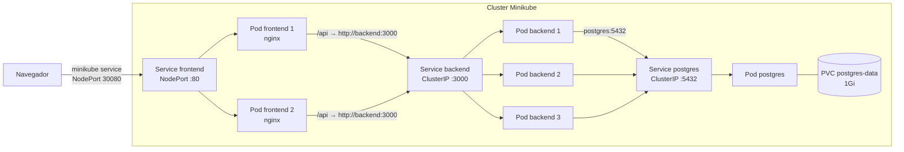

# Reserva de Salas no Kubernetes (Minikube)

Mensal 2: migração do projeto do Mensal 1, o **Sistema de Reserva de Salas** (React + Vite, Node.js + Express + Prisma e PostgreSQL), da AWS (S3, Elastic Beanstalk e RDS) para um cluster Kubernetes local com **Minikube**.

A aplicação não foi reescrita. O código veio dos repositórios do Mensal 1 (o histórico de commits foi preservado em `backend/` e `frontend/`). As únicas adaptações foram as necessárias para rodar no cluster, listadas em [Adaptações feitas](#adaptações-feitas).

---

## Arquitetura



Versão em imagem para a apresentação: [`docs/arquitetura.png`](docs/arquitetura.png).

| Componente | Recurso | Réplicas | Service | Porta | Imagem |
|---|---|---|---|---|---|
| Frontend (React compilado + nginx) | Deployment `frontend` | 2 | `frontend` **NodePort** (30080) | 80 | `reserva-frontend:1.0` |
| Backend (API Node.js/Express/Prisma) | Deployment `backend` | 3 | `backend` **ClusterIP** | 3000 | `reserva-backend:1.0` |
| Banco (PostgreSQL 15) | Deployment `postgres` + PVC | 1 | `postgres` **ClusterIP** | 5432 | `postgres:15-alpine` |
| Configuração | ConfigMap `reserva-config`, ConfigMap `postgres-init`, Secret `reserva-secret` | | | | |

**Como os componentes se comunicam**

1. O navegador acessa só o frontend, pelo Service `frontend` (NodePort). Esse é o único ponto de entrada da aplicação.
2. O React chama a API em `/api/...`, no mesmo endereço do site. O nginx do pod do frontend repassa essas chamadas para `http://backend:3000`. `backend` é o nome do Service, resolvido pelo DNS interno do cluster (CoreDNS).
3. O Service `backend` distribui cada requisição entre os 3 pods da API (balanceamento feito pelo kube-proxy).
4. A API conecta no banco por `postgres:5432`, o nome do Service do banco. A string de conexão é montada a partir do ConfigMap (host, porta, nome do banco) e do Secret (usuário e senha).
5. Backend e banco são `ClusterIP`, então não existe acesso a eles de fora do cluster.
6. Os dados do banco ficam num PersistentVolumeClaim e sobrevivem à exclusão do pod.

---

## Estrutura do repositório

```
backend/                 API do Mensal 1 + adaptações
  Dockerfile             build multi-stage (TypeScript -> dist/), roda como usuário node
  src/server.ts          rotas da API (+ /health e nome do pod na resposta)
  init.sql               criação das tabelas
frontend/                React do Mensal 1 + adaptações
  Dockerfile             build multi-stage (Vite -> nginx)
  nginx/default.conf.template   proxy /api -> Service backend
k8s/                     manifestos aplicados com "kubectl apply -f k8s/"
  01-configmap.yaml      configurações não sensíveis
  02-secret.yaml         usuário e senha do banco
  03-postgres-init.yaml  init.sql como ConfigMap
  10..12-postgres-*      PVC, Deployment e Service do banco
  20..21-backend-*       Deployment (3 réplicas) e Service do backend
  30..31-frontend-*      Deployment (2 réplicas) e Service do frontend
  opcional/              NetworkPolicy (precisa de --cni=calico)
.github/workflows/ci.yml pipeline que testa tudo num Minikube a cada push
docs/                    roteiro da apresentação e diagrama
evidencias/              prints da execução
```

---

## Pré-requisitos (Windows)

- **Docker Desktop** instalado e aberto
- **Minikube** e **kubectl**

No PowerShell:

```powershell
winget install Kubernetes.minikube
winget install Kubernetes.kubectl
```

Feche e abra o PowerShell depois de instalar. Confira:

```powershell
docker version
minikube version
kubectl version --client
```

---

## Passo a passo

Rode todos os comandos no PowerShell, a partir da pasta raiz do repositório.

### 1. Iniciar o Minikube

```powershell
minikube start --driver=docker
kubectl get nodes
```

O nó `minikube` deve aparecer como `Ready`.

### 2. Disponibilizar as imagens no Minikube

As imagens são construídas **dentro** do Minikube, então o cluster já as encontra sem precisar de registry:

```powershell
minikube image build -t reserva-backend:1.0 .\backend
minikube image build -t reserva-frontend:1.0 .\frontend
minikube image ls | Select-String reserva
```

> Alternativa: apontar o Docker do terminal para o Docker do Minikube e usar `docker build`:
> ```powershell
> & minikube -p minikube docker-env --shell powershell | Invoke-Expression
> docker build -t reserva-backend:1.0 .\backend
> docker build -t reserva-frontend:1.0 .\frontend
> ```

### 3. Aplicar os manifestos

```powershell
kubectl apply -f k8s/
```

### 4. Aguardar tudo subir

```powershell
kubectl get pods -w
```

Espere todos os pods ficarem `Running` e `1/1` (Ctrl+C para sair). Os pods do backend ficam um tempo em `Init:0/1`: é o initContainer esperando o banco aceitar conexões. Também dá para esperar com:

```powershell
kubectl rollout status deployment/postgres
kubectl rollout status deployment/backend
kubectl rollout status deployment/frontend
```

### 5. Acessar a aplicação

```powershell
minikube service frontend --url
```

O comando mostra um endereço como `http://127.0.0.1:54321`. Abra esse endereço no navegador.

> No Windows com driver Docker, **esse terminal precisa ficar aberto**: ele mantém o túnel até o cluster. Abra outro PowerShell para os próximos comandos.

A tela mostra as listas de Unidades, Setores, Salas e Reservas, e no topo o nome do pod do backend que respondeu.

### 6. Testar a API pelo terminal (opcional)

Em outro PowerShell, troque a porta pela que apareceu no passo 5:

```powershell
$URL = "http://127.0.0.1:54321"

Invoke-RestMethod "$URL/api/health"
Invoke-RestMethod "$URL/api/salas"
Invoke-RestMethod -Method Post "$URL/api/unidades" -ContentType "application/json" -Body '{"nome":"Bloco A","descricao":"criado pelo terminal"}'
Invoke-RestMethod "$URL/api/unidades"
```

---

## Demonstrações pedidas

### Pods, Services e Deployments

```powershell
kubectl get pods -o wide
kubectl get services
kubectl get deployments
```

### Balanceamento de carga entre os pods

Cada resposta da API traz o nome do pod que atendeu. Pelo navegador (passando pelo nginx):

```powershell
1..10 | ForEach-Object { (Invoke-RestMethod -DisableKeepAlive "$URL/api/").pod }
```

De dentro do cluster, do jeito que o frontend chama o backend (pelo nome do Service):

```powershell
kubectl exec deploy/frontend -- sh -c 'for i in 1 2 3 4 5 6 7 8 9 10; do wget -qO- http://backend:3000/; echo; done'
```

Os nomes dos pods se alternam entre as 3 réplicas. O header `X-Frontend-Pod` mostra também qual dos 2 pods do frontend respondeu:

```powershell
1..6 | ForEach-Object { (Invoke-WebRequest -UseBasicParsing -DisableKeepAlive "$URL/").Headers["X-Frontend-Pod"] }
```

### Recriação automática de um Pod

```powershell
kubectl get pods -l app=backend
kubectl delete pod <NOME-DE-UM-POD-DO-BACKEND>
kubectl get pods -l app=backend -w
```

Um pod novo é criado na hora (coluna `AGE` com poucos segundos). O Deployment quer 3 réplicas, e o ReplicaSet recria o que faltar. A aplicação continua respondendo durante a troca, porque os outros 2 pods seguem atendendo.

Para pegar o nome automaticamente:

```powershell
$POD = kubectl get pods -l app=backend -o jsonpath="{.items[0].metadata.name}"
kubectl delete pod $POD
kubectl get pods -l app=backend -w
```

### Persistência do banco

```powershell
kubectl delete pod -l app=postgres
kubectl get pods -l app=postgres -w
```

Depois que o novo pod do Postgres ficar `Running`, recarregue o navegador: os dados continuam lá, porque estão no PVC `postgres-data`. Durante os segundos em que o banco está fora, a readinessProbe (`/health`) tira os pods do backend do balanceamento e eles voltam sozinhos.

### Escalar

```powershell
kubectl scale deployment backend --replicas=5
kubectl get pods -l app=backend
kubectl scale deployment backend --replicas=3
```

### ConfigMap e Secret

```powershell
kubectl get configmap reserva-config -o yaml
kubectl get secret reserva-secret -o yaml
kubectl exec deploy/backend -- printenv PORT DB_HOST POSTGRES_DB
```

- **ConfigMap `reserva-config`:** nome do banco, host e porta do banco, porta da API, `NODE_ENV` e o endereço do backend usado pelo nginx.
- **Secret `reserva-secret`:** usuário e senha do Postgres. O Deployment do backend monta a `DATABASE_URL` juntando os dois.
- **ConfigMap `postgres-init`:** o `init.sql` que cria as tabelas na primeira subida do banco.

### Logs

```powershell
kubectl logs -l app=backend --prefix
kubectl logs deploy/postgres
```

---

## Adaptações feitas

| Onde | O que mudou | Por quê |
|---|---|---|
| `backend/src/server.ts` | Rota `/health` que testa o banco | readinessProbe: o pod só recebe tráfego se o banco responde |
| `backend/src/server.ts` | Nome do pod na rota `/` e no header `X-Pod` | Demonstrar o balanceamento |
| `backend/src/server.ts` | Tratamento de `SIGTERM` | Encerrar limpo quando o Kubernetes exclui o pod |
| `backend/Dockerfile` | Multi-stage, `npm ci`, usuário `node` | Imagem final sem ferramentas de build, sem rodar como root |
| `frontend/Dockerfile` | Multi-stage: build com Vite e servido por nginx | Antes rodava o servidor de desenvolvimento (`npm run dev`) |
| `frontend/nginx/` | Proxy `/api` -> Service `backend` | O navegador não precisa acessar o backend direto |
| `frontend` (build) | `VITE_API_URL=/api` | Antes apontava para a URL do Elastic Beanstalk |
| `frontend/src/App.tsx` | Mostra o pod do backend que respondeu | Demonstração no navegador |

### Equivalência com a arquitetura AWS do Mensal 1

| AWS (Mensal 1) | Kubernetes (Mensal 2) |
|---|---|
| S3 (site estático) | Deployment `frontend` com nginx, 2 réplicas |
| Elastic Beanstalk + Auto Scaling Group | Deployment `backend` (ReplicaSet mantém 3 réplicas) |
| Application Load Balancer | Service `backend` (kube-proxy) |
| RDS PostgreSQL em subnet privada | Deployment `postgres` + PVC, Service ClusterIP |
| Security Groups | Services ClusterIP (+ NetworkPolicy opcional) |
| Variáveis do Elastic Beanstalk | ConfigMap e Secret |

---

## Atualizar depois de mudar o código

```powershell
minikube image build -t reserva-backend:1.0 .\backend
kubectl rollout restart deployment/backend
kubectl rollout status deployment/backend
```

O mesmo vale para o frontend (`.\frontend` e `deployment/frontend`). Depois de editar um YAML, rode `kubectl apply -f k8s/` de novo.

---

## Pipeline de CI (GitHub Actions)

`.github/workflows/ci.yml` roda a cada push ou Pull Request na `main`:

1. **Build:** `npm ci` e `npm run build` do backend e do frontend.
2. **Validação dos manifestos:** `kubeconform` confere todos os YAML contra o schema do Kubernetes.
3. **Deploy de teste:** sobe um Minikube na máquina do GitHub, constrói as imagens, aplica `k8s/`, espera os Deployments e testa:
   - frontend, API e gravação no banco;
   - balanceamento entre os pods do backend;
   - recriação automática de um pod excluído.

Se qualquer etapa falhar, a pipeline para e mostra os logs dos pods. As pipelines antigas da AWS ficaram em `backend/.github` e `frontend/.github` só como histórico; o GitHub só executa as que estão na raiz.

---

## NetworkPolicy (opcional)

`k8s/opcional/networkpolicy.yaml` bloqueia toda entrada nos pods e libera só **qualquer origem -> frontend:80**, **frontend -> backend:3000** e **backend -> postgres:5432**. O CNI padrão do Minikube não aplica NetworkPolicy, então para usar é preciso iniciar com Calico:

```powershell
minikube start --driver=docker --cni=calico
kubectl apply -f k8s/
kubectl apply -f k8s/opcional/
```

---

## Problemas comuns

| Sintoma | Causa | Solução |
|---|---|---|
| `ErrImagePull` / `ImagePullBackOff` no backend ou frontend | A imagem não foi construída no Minikube | Refaça o passo 2 e confira com `minikube image ls` |
| Backend parado em `Init:0/1` | O banco ainda não está pronto | Espere; veja com `kubectl logs deploy/postgres` |
| `CrashLoopBackOff` no backend | Erro ao iniciar a API | `kubectl logs -l app=backend --prefix` |
| Navegador não abre o endereço | O terminal do `minikube service` foi fechado | Rode `minikube service frontend --url` de novo e mantenha aberto |
| Tela abre, mas as listas não carregam | Backend sem pods prontos | `kubectl get pods`, `kubectl describe pod <nome>` |
| Postgres não sobe após mudar a senha no Secret | O volume já foi inicializado com a senha antiga | `kubectl delete -f k8s/` e `kubectl delete pvc postgres-data` (apaga os dados) |

---

## Limpar

```powershell
kubectl delete -f k8s/     # remove a aplicação (o PVC também, e os dados junto)
minikube stop              # desliga o cluster
minikube delete            # apaga o cluster inteiro
```

---

## Limitações conhecidas

- Cluster de um nó só: as réplicas protegem contra falha de pod, não contra falha da máquina.
- Postgres com 1 réplica. Para alta disponibilidade seria um StatefulSet com replicação ou um operador (ex.: CloudNativePG).
- O Secret está no repositório para a demonstração. Em produção viria de um cofre (Sealed Secrets, External Secrets) e não do Git.
- Sem HTTPS e sem Ingress. O acesso é pelo NodePort via `minikube service`.
- Sem autoscaling (HPA). As réplicas são fixas.

---

## Integrantes

| Nome | Papel |
|---|---|
| | |
| | |
| | |
